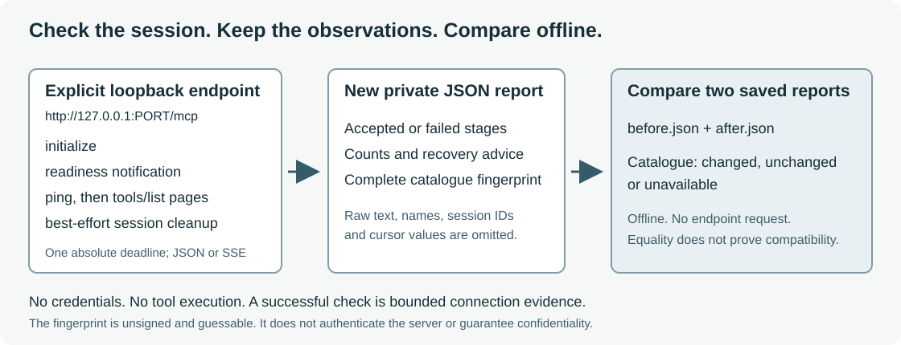

# MCP Connect Diagnoser

**“Initialize succeeded” is not the same as “this MCP session works.”**

Check a deliberately started local Streamable HTTP MCP server, retain each stage's outcome, and compare saved tool-catalogue observations. This small developer CLI checks initialize, readiness, ping and advertised tools without calling a tool or accepting credentials.

Python 3.11–3.13 · Dependency-free runtime · Literal loopback only · JSON and SSE · No model, account or Docker required for the supplied example



| What you learn | What you do not learn |
| --- | --- |
| Which supported session stage failed | Which private middleware caused an unexplained 403 |
| Whether complete advertised catalogues differ | Whether tool implementations are semantically compatible |
| Whether a bounded stream resumed without replaying the POST | Whether arbitrary operations are exactly-once |
| Whether supported protocol envelopes passed | Whether a server is safe, authenticated or production-ready |

## Try it without an existing server

From the source directory or extracted source distribution, with [uv](https://docs.astral.sh/uv/):

```sh
uv venv --python 3.13
uv pip install --python .venv/bin/python .
.venv/bin/mcp-connect-diagnoser --version
.venv/bin/python examples/quickstart.py --output-dir .release-scratch/quickstart-1
```

Version prints `mcp-connect-diagnoser 1.0.2`. The example starts an owned server at an ephemeral loopback port, checks JSON/SSE sessions, detects a same-count metadata change, retains an intentional ping failure, checks recovery and closes the server. Installation may contact package registries; runtime checks do not.

The final line contains these values (`requestID` varies):

```json
{"requestID":"...","verified":true,"catalogue_status":"changed","failure_stage":"ping","recovered":true,"reports_saved":6}
```

The new private directory contains `before.json`, `after.json`, `failed.json`, `recovered.json`, `drift.json` and `recovery.json`. A failure is preserved, not silently retried. Reusing the directory exits 2; choose a fresh name to repeat it.

```sh
.venv/bin/mcp-connect-diagnoser compare .release-scratch/quickstart-1/before.json .release-scratch/quickstart-1/after.json
```

Expect `same_observations: false` and a catalogue comparison with `status: "changed"`. Comparison is offline and works after the example server exits.

## Check your own local server

Replace this example port/path with a development service you deliberately run:

```sh
.venv/bin/mcp-connect-diagnoser probe http://127.0.0.1:8000/mcp --timeout 5 --output check-1.json
```

Only explicit plain-HTTP `127.0.0.1` or `[::1]` addresses are accepted. `localhost`, remote/HTTPS addresses, user information, queries and fragments are rejected before connecting. Redirects are not followed; environment proxies are ignored.

Supported negotiated versions are **2025-11-25, 2025-06-18 and 2025-03-26**. The tool does not claim support for every newer protocol revision. A successful report means the supported initialize/initialized/ping stages and advertised discovery checks completed. Cleanup has its own outcome: best-effort session DELETE shares the original deadline and can remain incomplete.

| Exit | Meaning |
| --- | --- |
| 0 | The requested bounded checks passed, or two valid reports were compared—even if they differ |
| 1 | A connection check failed, or a valid frozen native record retains failed controls/differences |
| 2 | Invalid input, usage or output-file problem |

Reports/errors include a `requestID`. Invalid input is JSON on stderr. Without `--output`, reports go to stdout. Files written by the tool start with mode 0600 and must be new; existing destinations and symlinks are refused before connecting. Shell redirection and directory permissions are your responsibility.

## Compare a change or check several endpoints

```sh
.venv/bin/mcp-connect-diagnoser compare check-1.json check-2.json --output changes.json
```

The catalogue fingerprint includes names, input/output schema fields and advertised metadata after complete discovery. It normalizes tool order, object-key order and page partition; arrays retain their order. `unavailable` means complete comparison is not possible, including incomplete discovery and legacy reports. A metadata difference is not necessarily a behavioral incompatibility.

For several services, use an explicit `targets.json` containing only ports you run:

```json
{"schema_version":1,"targets":[{"label":"catalog","url":"http://127.0.0.1:8000/mcp"},{"label":"search","url":"http://127.0.0.1:8001/mcp"}]}
```

```sh
.venv/bin/mcp-connect-diagnoser probe-many targets.json --timeout 5 --max-seconds 10 --output checks.json
```

Every target is validated before connecting. At most 16 targets run with four concurrent probes under one total deadline. Choose non-sensitive labels; endpoint URLs are omitted. Saved endpoint-set reports can be compared offline.

## Compatibility without unnecessary disclosure

Legal common `_meta` objects on supported ping requests/results are accepted without interpreting or echoing them. Server ping progress tokens are strings or finite numbers, not booleans. Ignored result extensions are not instructions or authorization. Malformed metadata and unsupported server requests still fail explicitly.

[Wire-level metadata tests](tests/test_ping_metadata.py) cover all supported protocol versions, server-initiated SSE pings, negative envelopes and non-disclosure. The separate [locked-SDK compatibility table](docs/COMPATIBILITY.md) records native sessions and the pinned Python SDK's restriction on fractional progress tokens. These are bounded compatibility checks, not a claim that every MCP implementation conforms. [Validation checks](docs/VALIDATION.md).

## Find and recover a failure

```sh
.venv/bin/mcp-connect-diagnoser --help
.venv/bin/mcp-connect-diagnoser probe --help
.venv/bin/mcp-connect-diagnoser compare --help
```

| Observation | Useful next action |
| --- | --- |
| Connection refused or deadline exhausted | Check your listener/port/path; explicitly retry into a fresh report |
| HTTP 401 | Use your authenticated client and trusted authorization logs; this probe accepts no credentials |
| HTTP 403 | Inspect Host, Origin and authorization logs; status alone cannot identify the rejecting layer |
| HTTP 406 | Inspect Accept handling; the probe sends both JSON and event-stream types |
| Initialize succeeds but ping/discovery fails | Investigate the named later stage rather than treating initialize as completion |
| A standard JSON-RPC error category is reported | Follow the stage-specific `next_step` and inspect trusted logs; the reported category does not establish the cause |
| Repeated cursor or unavailable catalogue | Retain the report and inspect complete tools/list pagination in your usual client |
| Output exists | Preserve the prior attempt and choose another path |

Raw response bodies, instructions, server/session/tool names and cursor values are omitted. Schemas are neither executed nor dereferenced. Catalogue hashes are unsigned and guessable: reduced content is not authentication or a confidentiality guarantee.

## Scope and stability

V1 retains session schema 3, endpoint-set schema 1, comparison schema 1 and legacy readers. [Stable contracts](docs/STABILITY.md) and [usage/API](docs/USAGE.md) define supported interfaces and compatibility. Request IDs, advice, whitespace and property order are not stable comparison inputs.

Bounds are an absolute integer 1..30-second deadline, 256 tools across four pages, 64 SSE events per logical request and 256 KiB per physical response. At most eight server pings are answered. A closed SSE stream may resume by GET twice per session with session/protocol/Last-Event-ID headers, **without repeating its operation POST**. Other server requests fail. Schema checks cover envelopes, not full JSON Schema semantics.

Resumption preserves UTF-8 event-ID bytes, including non-ASCII IDs, up to 1,024 bytes. Empty IDs cannot resume; controls, DEL, edge spaces and repeated IDs are refused within this tool's bounded profile. Session IDs retain their separate visible-ASCII restriction. [Socket regressions](tests/test_resume_encoding.py) check exact cursor bytes, both sides of the byte limit, refusal and cleanup. These fixtures complement the separately pinned native SDK gate.

Remote/authenticated services, HTTPS, OAuth, browser/CORS, stdio, legacy transports, subscriptions and tool execution are unsupported. Production, human-usability and scientific-efficacy qualifications remain **NOT RUN**. A native SDK client can expose equivalent observations and the actual private differences; this tool packages bounded checks and reduced-content offline records, not proven time savings or superiority.

## Verify and reproduce

```sh
sh scripts/verify-release.sh
uvx --from ruff==0.17.1 ruff check src tests scripts examples
```

The gate runs source tests, builds an sdist and wheel, installs outside the checkout, and exercises installed tests, quickstart and CLI. CI includes Python 3.11–3.13, pinned lint and a separate native SDK job. Inspect the exact commit's executions; workflow presence is not a passing result.

For optional locked native SDK reproduction, use Python 3.13.15, Node 24.15.0 and npm 12.0.0:

```sh
mkdir -p .release-scratch
UV_PROJECT_ENVIRONMENT="$PWD/.release-scratch/sdk-python" uv sync --frozen --project tests/sdk
(cd tests/sdk && npm ci --ignore-scripts --no-audit --no-fund)
SDK_PYTHON="$PWD/.release-scratch/sdk-python/bin/python" \
NODE_BIN="$(command -v node)" \
NATIVE_OUTPUT="$PWD/.release-scratch/native.json" sh scripts/verify-native.sh
.venv/bin/mcp-connect-diagnoser summarize .release-scratch/native.json
```

Installation contacts public registries. The gate uses synthetic SDK fixtures/credentials and retains the frozen 168-request middleware/proxy matrix. Separate reports check two stateful JSON/SSE sessions, four native metadata sessions and a typed-construction limitation. The three native output paths must be unused. `summarize` accepts only the frozen native format; session and metadata reports have their own shapes. It refuses non-regular inputs without waiting on FIFO writers.

[Evaluation](docs/EVALUATION.md) · [Design](docs/DESIGN.md) · [Limitations](docs/LIMITATIONS.md) · [References](docs/REFERENCES.md) · [Release policy](docs/RELEASING.md) · [Changelog](CHANGELOG.md) · [Contributing](CONTRIBUTING.md) · [Security/support](SECURITY.md) · [MIT license](LICENSE)

Personal R&D by Jason Lovell, independent of employer work, endorsement or policies. Optional third-party components retain their own terms.
